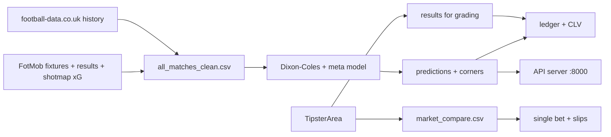

# Football Prediction

[](https://github.com/xline8/footballprediction/actions/workflows/tests.yml)
[](https://www.python.org)
[](https://fastapi.tiangolo.com)
[](https://github.com/xline8/footballprediction/blob/main/LICENSE)
[](https://github.com/xline8/footballprediction/releases)

This repository runs my pre-match football models. It fits Dixon-Coles and a
meta model for the top five European leagues, prices domestic cups, and runs
separate gated engines for 156 leagues. The daily job publishes probabilities
before kickoff, joins them to 1xBet prices scraped from TipsterArea, and grades
the results.

The research question is whether those prices leave an exploitable edge. The
graded evidence so far says no. I keep the system running because a prediction
made before kickoff and graded afterwards is more useful than another
backtest. Markets that fail their walk-forward gate do not run.

## Coverage

The top-five chain and the world runner use different executors, but they are
one research system and follow the same rule: each published market must pass
its own gate.

| Scope | Competitions | Markets |
|---|---|---|
| Top five European leagues | Premier League, La Liga, Bundesliga, Serie A, Ligue 1 | 1X2, double chance, over/under goals, BTTS; corners (full time, first half, by half); shots on target (full time, first half, by half); cards; goals by half |
| Domestic cups | EFL Cup, DFB Pokal | 1X2 with advance probabilities for single-leg ties; corners |
| World league programme | 156 leagues built and gated individually; 62 leagues and 123 markets in the daily runner | Goals, corners, shots on target, total shots, cards; only the markets that passed each league's gate |

Fixtures, results, and shotmap xG come from FotMob. TipsterArea supplies
the market odds snapshots behind the price comparison and a results
cross-check. Historical training data and closing odds come from
football-data.co.uk, with Understat xG for the seasons before the FotMob
switch. Section [Data sources](#data-sources) lists what each source feeds.

## Measured results

- Calibration. On the stored walk-forward probabilities (records schema
  v2), the meta stack scores a pooled Brier of 0.5766 and RPS of 0.1956
  across the top five leagues, level with the opening market (0.5764 /
  0.1955). On 9,946 matches shared with FiveThirtyEight's SPI (January 2018
  to June 2023), it scores log loss 0.9740 against SPI's 0.9821.
- xG blend fit. Fitting Dixon-Coles on a 0.5 goals + 0.5 xG target beat
  goals-only out of sample (log loss 0.98624 vs 0.99304, walk-forward
  2021/22–2025/26, n = 8,889) and passed all three go-live gates, so `blend`
  is the production default. See EXPERIMENT_XG_DC.md.
- Graded ledger. 358 historical league picks are graded in
  `ledger/ledger_summary.json`: ROI −5.79% at opening odds, mean CLV EV
  −0.0773 against closing odds (Pinnacle, then AvgC, then B365C), beat-close
  rate 53.6%, CLV coverage 100%. The model often takes a better price than
  the close and still loses money. CLV, not settlement ROI, is the headline
  metric.
- The live-pick edge band does not exist. The policy engine only fires
  at an edge of 0.20–0.22 over the market. An experiment over the full
  2017/18–2025/26 walk-forward history (EXPERIMENT_EDGE_BAND.md) found that
  band fires zero times: the meta model's edge over the Shin-fair market
  maxes at about +0.08. Live picks are therefore 0, as a measured property
  of this model against this market, not as a configuration choice.
- Corners. A walk-forward calibration check against actual corner
  counts (HC/AC, pooled n = 12,457) found per-division bias between −0.06
  and +0.23 corners and a ladder deviation of −0.0015 at the 9.5 line
  (Brier 0.2470). Both correction gates failed, so the corner model ships
  unchanged.
- Shots on target and cards. The SOT model (pooled Poisson regression
  ratings, negative binomial dispersion r = 79.94, Beta-Binomial on-target
  ratio) passed its walk-forward gate at the 9.5 line: log loss 0.6304,
  calibration within 0.2 points, no top-five division worse than the pooled
  model by more than 0.0003. The cards model passed its gate the same week
  (log loss 0.6555 at the 4.5 line against a 0.6634 base rate).
- World league programme. 785 market candidates across 156 leagues were
  built and gated one by one: 122 passed (28 clean, 94 provisional), 309
  failed, 353 could not be built for lack of data. Goals passed about 3%
  of built candidates; corners 58%, shots on target 48%, total shots 51%.
  The full audit is `league/AUDIT.md`.
- Validation. Every experiment runs leak-free walk-forward validation
  with proper scoring rules (log loss, Brier, per-class) and a dual gate:
  a log-loss safety check plus a fixed-threshold yield check with a
  bootstrap significance test. A de-vigging bug that inflated a false
  +3.23% strategy was found and fixed; a small-sample +6.7% policy was
  kept out because its bootstrap p-value was 0.216.

## Quick start

On Windows, `start.bat` creates `.venv`, installs `requirements.txt`, and opens
the Control Center. On Linux or macOS, create the environment yourself, install
the same requirements, then run `python football_cli.py`. The menu exposes the
daily update, full pipeline, local API, project status, and credits.

Run the end-to-end pipeline directly:

```
python setup_cache.py
python pipeline_orchestrator.py --run-all
```

Individual pieces also run standalone: `python model_v2.py final` fits and
prints the scoring report, `python backtest_value.py` reruns the value-bet
backtest, and `python refresh_fixtures.py` pulls fresh fixtures.

The optional API server serves the current predictions, picks, odds, and
corners on port 8000:

```
python api_server.py
```

The live deployment runs it under a systemd unit with Restart=always. That
unit is kept with the deployment and is not part of this repository.

## How it works

Main pipeline order (`pipeline_orchestrator.py --run-all`):

```
refresh training data → check data → build xG → fit models → score upcoming
→ score corners → integrate odds → generate picks → validation → ta_model
→ predict cups → status
```



| Component | File | Role |
|---|---|---|
| Dixon-Coles engine | `model_v2.py` | Bivariate Poisson model with low-score dependency correction and decayed team ratings. Fit mode `DC_FIT_MODE` (`goals` or `blend`; default `blend` = 0.5·goals + 0.5·xG where xG exists) |
| Meta model | `make_picks_live.py`, `backtest_picks.py` | Walk-forward multinomial logistic stack of exactly nine logits: the Dixon-Coles 1X2 probabilities, the T3 feature-model probabilities, and logit(1/opening odds) per outcome. Fitted monthly on past records only; the same recipe is kept in `experiments/go_live_gates.py` |
| Matrix pricing | `matrix_pricer.py` | Builds the bivariate Poisson scoreline matrix and meta-calibrates it so summed 1X2 marginals match the meta model. Experiment-only: the daily O/U and BTTS probabilities come from the Dixon-Coles model (`model_v2.py`), not from this matrix |
| Corner model | `model_corners_v3.py` | Poisson model predicting team corner counts and corner O/U lines from rolling shot statistics; fitted parameters in `ta/corner_params.json`. Assessed on calibration against actual counts, because no bookmaker corner-odds feed is connected |
| xG dataset | `data_enrichment/build_xg_matches.py` | Builds `xg_raw/xg_matches.csv` (per-match xG keyed to the clean match data) from FotMob shotmap xG for current seasons and the tracked Understat dumps for earlier ones; consumed by the blend fit and the feature model |
| Market orchestration | `market_orchestration.py` | Syncs TipsterArea match-page odds for every model fixture in the today..+4 window during the daily run, then builds `market_compare.csv`: per fixture and market, the 1xBet price, the cross-bookmaker median, a normalised implied probability, and the bookmaker count. Also writes the daily archive and routes cup picks into the ledger |
| Policy engine | `backtest_picks.py` | Filters betting decisions after the model (edge thresholds, overlays, staking) so calibration stays intact; candidate policies must clear the dual gate before going live |
| Shots on target | `model_sot.py` | Pooled Poisson regression attack/defence ratings, negative binomial dispersion, Beta-Binomial on-target ratio. Walk-forward log loss 0.6304 at the 9.5 line |
| Cards | `model_cards.py` | Total match cards from team card rates. The referee is not used: measured referee excess variance in the top five was zero |
| Half splits | `model_goals_halves.py`, `model_corners_halves.py`, `model_sot_halves_share.py` | Full-time predictions split by frozen constant league shares (goals 0.4419 home / 0.4440 away for the first half). Per-match half share measured as noise around the constant over 16,110 matches, so no per-match half model is fitted |
| Cups | `predict_cups.py` | Predicts EFL Cup and DFB Pokal ties from league fits: each team maps to its division, goal lambdas come from the two divisions' fits, and the tie total is rescaled to the competition's own measured scoring rate. Single-leg ties also get advance probabilities (`p_adv_h`, `p_adv_a`) from extra-time lambdas and penalties weighted by the 90-minute win probabilities. Cup results never enter league training data, and cup rows never mix into the league prediction files |
| League runner | `league/runner/run_daily.py` | Runs every gated league market in `league/runner/active.yaml`: incremental FotMob pull, predictions, settlement. Per-league failures stay inside their league |

`league/` holds one self-contained engine per
league for 156 leagues. Each league was built through the same six stages
(data, EDA, design, fit, gate, report), and each market was gated on its
own walk-forward and sealed-window numbers. A market that fails does not
run. `league/PROGRAM_STATUS.md` is the build ledger, `league/AUDIT.md` the
final audit, and `league/IMPROVEMENT_PROGRAM.md` the charter for the
follow-up programme, which re-tests failed candidates only under new,
pre-registered methods.

## Daily operation

`run_daily_shadow.py` is the daily production chain: twenty-three numbered
steps, each isolated with try/except, writing a per-product status file
(`logs/run_status_<date>.json`) so a failed product is named instead of
failing silently. Two steps gate the rest. The fixture step refreshes from
FotMob when the stalest league fixture file is over 12 hours old and
refuses to predict at all when fixtures remain over 48 hours old. When the
prediction step fails or returns a partial status, every prediction
consumer (live picks, market sync and compare, safest picks,
recommendations, the daily archive) is skipped rather than run on
yesterday's files, and the run exits 1. The remaining steps predict
corners, shots on target, cards, half splits, and cup ties; sync results
and grade the open bets; build `market_compare.csv`; build the safest
picks and the daily recommendations; archive the day's outputs under
`archive/<date>/`; and grade the statistics markets (SOT, cards,
first-half corners, half splits) into their own ledger. Statistics-market
snapshots were only archived from 2026-11-08 on, so those grades cannot be
backfilled. The API server refuses to serve a predictions file older than
48 hours (HTTP 503), so a dead pipeline shows up as an error instead of
stale numbers.

Two ledgers grade two different things, and this README keeps them
separate. Historical and shadow picks carry the ROI and CLV numbers under
Measured results. Live picks from the policy engine are 0, for the
edge-band reason given there. The daily recommendations below are a
separate deterministic product built from model probabilities and real
1xBet prices; they are not policy-engine picks and carry no edge claim.

`slip_recommender.py` builds three recommendation files per
report date from real 1xBet odds in `market_compare.csv` joined to model
probabilities (markets 1X2 / DC / OU / BTTS; one leg per match), produced
in the daily chain and archived daily:

- `recommended_single.csv`: the day's single bet, chosen by highest EV
  (`p_model * o_1xbet - 1`) among legs with `p_model >= 0.45` and
  `o_1xbet >= 1.40` (tie-break: probability, then odds). The `below_floor`
  column is true only when the relaxed 0.40 / 1.30 floor had to be used.
- `recommended_slip.csv`: a slip with total odds in the 1.85–2.15 band
  (target 2.0): 2–4 legs from the report date only, `p_model >= 0.50`,
  `o_1xbet >= 1.20`, highest joint probability (tie-break total EV).
  Without an in-band combination, the closest-to-2.0 combination is
  emitted with `in_band=false`.
- `recommended_slip10.csv`: a slip with total odds in the 9.0–11.0 band
  (target 10.0): 3–6 legs, `p_model >= 0.35`, `o_1xbet >= 1.30`, highest
  joint probability. The pool starts at the report date and expands day
  by day (max +4) only until an in-band combination exists; every leg row
  carries its own match date and `pool_expanded_to` records how far the
  pool reached.

`grade_recommendations.py` settles every issued selection on
the 90-minute score in `ta/results.csv`. League corner picks settle on the
HC/AC counts in `all_matches_clean.csv` once those are published. A slip
is graded as a unit: one losing leg loses it, a push leg drops out, and a
pending leg keeps the unit pending. Rows the current archives no longer
regenerate are re-graded directly from the store, and an orphaned slip's
legs are recovered from the content hash that names the unit, so an
issued selection is settled rather than deleted. Cup corner picks are not
graded, because no available results source records cup corner counts.
Grades append to `ledger/daily_pick_grades.jsonl`;
`ledger/calibration_summary.json` accumulates hit rate against stated
probability overall, per product, per market, and per probability band,
plus a Brier score for the safest picks. Both files are gitignored runtime
state. This is the project's calibration history.

## Automation

- Weekly refit. Every Monday at 07:00 WIB (00:00 UTC), `weekly_refit.sh`
  runs the full `--run-all` pipeline. The 07:00 start leaves a buffer after
  the last Sunday matches finish, at about 05:00 WIB. Before refitting, the
  training-data refresh re-downloads current-season football-data.co.uk
  CSVs (21 divisions) and the xG season dumps, rebuilds
  `all_matches_clean.csv`, and fails before rebuilding anything when a
  download is incomplete. Everything the refresh overwrites is backed up
  to timestamped `.bak-*` files and rolled back on failure. Validation
  checks that total rows, current-season rows, and per-division rows never
  decrease; a decrease caused by a legitimate football-data correction can
  be accepted once with `REFRESH_ACCEPT_SHRINK=1`.
- Watchdog. A check every 10 minutes curls `/api/health`; if the API
  is down it restarts the systemd service, reinstalling the unit first
  when the machine itself was replaced. It stays silent unless it had to
  act.
- League runner. A separate daily job runs the gated world leagues
  (62 leagues, 123 markets). It shares no execution path with the top-five
  chain, so a broken league engine cannot delay the morning report, and a
  top-five failure cannot stop the leagues.
- Health summary. `health_summary.py` prints one digest of both
  pipelines: API status, the top-five per-product run status, league
  runner counts, and the ages of the predictions file and the corner
  parameters (which fail their freshness gate at 14 days). It is scheduled
  after both morning reports and runs standalone.

## Reference

[QUANT_RESEARCH_REPORT.md](docs/QUANT_RESEARCH_REPORT.md) contains the
full scientific summary: the modeling milestones, the de-vigging and
small-sample lessons, and the market-efficiency evidence.

[EXPERIMENT_XG_DC.md](docs/EXPERIMENT_XG_DC.md) documents the xG-vs-goals
Dixon-Coles fit experiment and the go-live gates (meta stack, derivatives,
held-out seasons) behind the `blend` fit-mode default.

[EXPERIMENT_EDGE_BAND.md](docs/EXPERIMENT_EDGE_BAND.md) documents the
edge-band experiment and its UNVALIDATED verdict: the 0.20–0.22 band never
fires in walk-forward history, which is why the live policy engine emits
no picks.

[EXPERIMENTS_LOG.md](docs/EXPERIMENTS_LOG.md) is the experiment register
for the keep-or-revert loop. The scripts behind these documents live in
[experiments](experiments/); they are research code, not part of the daily
pipeline. Point-in-time working documents (audits, per-feature
verification reports, backlog lists) are not kept in the tree; they stay
readable in git history.

[MUSE_SNAPSHOT.md](MUSE_SNAPSHOT.md) records what the published tree
contains and which datasets it carries.

## Runtime data

The repository carries code, documentation, and the gathered datasets
listed in `MUSE_SNAPSHOT.md`: the FotMob full-response store for the top
five (7,532 matches), the SOT backfill raw responses, TipsterArea
fixtures, results and odds snapshots, the tracked Understat season dumps
(`xg_raw/`), the FotMob world index (233,619 matches), and the league
programme's gate evidence files. What the pipeline generates each day
stays per-machine runtime state and is gitignored: the ledger (`ledger/`,
including the daily calibration grades and summary), the daily archive
(`archive/`), fresh prediction and recommendation CSVs (the tree carries
a dated snapshot of them), the per-league data CSVs under
`league/*/data/` (regenerated by the per-league builders from the world
index), and `.env`.

Those files are not synced between machines, so two machines running the
same code can hold different ledgers and different cup scoring-rate
samples. When a number from one machine disagrees with a number from
another, check which machine produced it before treating either as wrong.

## Data sources

- **FotMob:** fixtures, full-time results, and shotmap xG for the top
  five since 2026-11, and the world warehouse behind the league
  programme: 233,619 matches across 158 FotMob league IDs, pulled through its
  public match endpoints.
- **football-data.co.uk:** historical league results and odds for all 21
  divisions, including the Pinnacle, market-average, and Bet365 closing
  prices behind the CLV numbers. Its CSVs also carry the HC/AC corner
  counts used to grade the corner model. The weekly refresh rebuilds them
  into `all_matches_clean.csv`.
- **Understat:** expected-goals data for the pre-FotMob seasons, kept as
  season dumps in `xg_raw/` and rebuilt into the xG match cache that the
  `blend` Dixon-Coles fit consumes.
- **TipsterArea:** full-time results for grading and a fixtures
  cross-check, scraped by `ta_scrape.py`. Its match pages carry the
  multi-bookmaker odds snapshots behind `market_compare.csv`. The 1xBet
  prices in the daily recommendations come from those pages; the project
  has no direct 1xBet feed. Cup fixtures and cup results come from here
  too.

## Environment & dependencies

The current data sources need no API keys. Optional overrides:
`FOOTBALL_DC_FIT_MODE` (`goals`|`blend`, default `blend`) and
`FOOTBALL_REFRESH_SEASON` (default `2627`).

Dependencies: `numpy` (see `requirements.txt`). The API server
(`api_server.py`) and scrapers use `fastapi`, `uvicorn`, `pydantic`,
`requests`, and `httpx`.

## Testing

Unit tests (120 at the time of writing) cover the core math (Shin
de-vigging, Dixon-Coles probabilities, cup advance probabilities, the
slip search, push-market fair odds), the recommendation settlement rules
(1X2, double chance, over/under, BTTS, corners, and slip units), and the
money ledger's settle rules (including quarter-line halves). They live in
`tests/test_units.py`, use fixed inputs, and need no data files, so
GitHub Actions runs them, plus a byte-compile of all sources, on every
push:

```
python -m pytest tests/ -q
python tests/test_units.py   # the same suite without pytest
```

`test_core.py` holds the data-dependent smoke tests. It needs the
generated data files, which are gitignored, so it runs in the full local
environment rather than in CI:

```
python test_core.py
```

## License

MIT. See [LICENSE](LICENSE).
