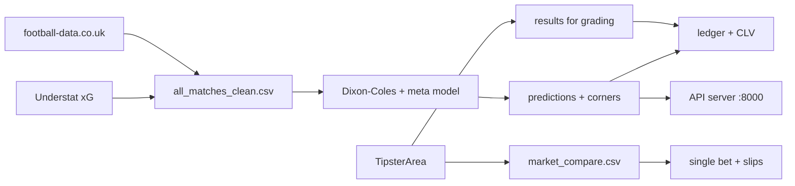

# Football 1X2 & Derivative Market Prediction

[](https://github.com/xline8/footballprediction/actions/workflows/tests.yml)
[](https://www.python.org)
[](https://fastapi.tiangolo.com)
[](https://github.com/xline8/footballprediction/blob/main/LICENSE)
[](https://github.com/xline8/footballprediction/releases)
[](#how-it-works)
[](#daily-recommendations-single-bet--slips)

A quantitative research engine that predicts pre-match football outcomes for
the top five European leagues (EPL, La Liga, Bundesliga, Serie A, Ligue 1),
plus EFL Cup and DFB Pokal ties, and prices derivative markets (Over/Under
goals, BTTS, corners) from a calibrated scoreline matrix.

The engine is built for research, not for chasing returns. It tests whether
bookmaker markets hide exploitable value. So far they do not, and the graded
ledger below is the evidence. The same pipeline still runs every day: it
publishes predictions, compares them with live 1xBet prices, and produces the
deterministic daily recommendations described further down.

## Contents

- [Measured results](#measured-results)
- [Quick start](#quick-start)
- [How it works](#how-it-works)
- [Live shadow tracker](#live-shadow-tracker)
- [Cups: EFL Cup & DFB Pokal](#cups-efl-cup--dfb-pokal)
- [Reference](#reference)
- [Daily recommendations (single bet + slips)](#daily-recommendations-single-bet--slips)
- [Automation](#automation)
- [Environment & dependencies](#environment--dependencies)
- [Runtime data](#runtime-data)
- [Credits](#credits)
- [Testing](#testing)

## Measured results

- **Calibration.** The meta model reaches a walk-forward log loss of 1.0013
  and Brier 0.5986, near the information ceiling implied by the market. A
  Dixon-Coles bivariate Poisson model, a feature model, and market odds are
  stacked into a multinomial logistic meta-model.
- **xG blend fit.** Fitting Dixon-Coles on a 0.5 goals + 0.5 xG target beat
  goals-only out of sample (log loss 0.98624 vs 0.99304, walk-forward
  2021/22–2025/26, n = 8,889) and passed all three go-live gates, so `blend`
  is the production default. See EXPERIMENT_XG_DC.md.
- **Graded ledger.** 358 historical league picks are graded in
  `ledger/ledger_summary.json`: ROI −5.79% at opening odds, mean CLV EV
  −0.0597 against closing odds (Pinnacle, then AvgC, then B365C), beat-close
  rate 57.5%, CLV coverage 100%. The model often takes a better price than
  the close and still loses money. CLV, not settlement ROI, is the headline
  metric.
- **The live-pick edge band does not exist.** The policy engine only fires
  at an edge of 0.20–0.22 over the market. An experiment over the full
  2017/18–2025/26 walk-forward history (EXPERIMENT_EDGE_BAND.md) found that
  band fires zero times: the meta model's edge over the Shin-fair market
  maxes at about +0.08. Live picks are therefore 0, as a measured property
  of this model against this market, not as a configuration choice.
- **Corner model calibration.** A walk-forward calibration check against
  actual corner counts (HC/AC, pooled n = 12,457) found per-division bias
  between −0.06 and +0.23 corners and a ladder deviation of −0.0015 at the
  9.5 line (Brier 0.2470). Both correction gates failed, so the corner model
  ships unchanged.
- **Discipline.** Every experiment runs leak-free walk-forward validation
  with proper scoring metrics (log loss, Brier, per-class) and a dual gate:
  a log-loss safety check plus a fixed-threshold yield check with a
  bootstrap significance test. A de-vigging bug that inflated a false
  +3.23% strategy was found and fixed; a small-sample +6.7% policy was kept
  out because its bootstrap p-value was 0.216.

## Quick start

Run the end-to-end pipeline:

```
python setup_cache.py
python pipeline_orchestrator.py --run-all
```

Individual pieces also run standalone: `python model_v2.py final` fits and
prints the scoring report, `python backtest_value.py` reruns the value-bet
backtest, and `python refresh_fixtures.py` pulls fresh fixtures.

The optional API server serves the current predictions, picks, odds, and
corners on port 8000:

```
python api_server.py
```

The live deployment runs it under a systemd unit with Restart=always.
That unit is kept with the deployment and is not part of this repository.

## How it works

Main pipeline order (`pipeline_orchestrator.py --run-all`):

```
refresh training data → check data → build xG → fit models → score upcoming
→ score corners → integrate odds → generate picks → validation → ta_model
→ predict cups → status
```

How the pieces connect:



| Component | File | Role |
|---|---|---|
| Dixon-Coles engine | `model_v2.py` | bivariate Poisson model with low-score dependency correction and decayed team ratings. Fit mode `DC_FIT_MODE` (`goals` or `blend`; default `blend` = 0.5·goals + 0.5·xG where xG exists) |
| Meta model | `experiments/experiment_meta.py`, `backtest_picks.py` | stacks logits of the DC model, the feature model, and market-implied probabilities with a walk-forward multinomial logistic regression; consumes sharp signals (Pinnacle deviation, shin-fair probabilities, midweek flags) |
| Matrix pricing | `matrix_pricer.py` | builds the bivariate Poisson scoreline matrix and meta-calibrates it so summed 1X2 marginals match the meta model; O/U and BTTS derive from that matrix |
| Corner model | `model_corners_v3.py` | Poisson model predicting team corner counts and corner O/U lines from rolling shot statistics (fitted parameters in `ta/corner_params.json`). Beats league base-rate on walk-forward log loss, Brier, MAE, RMSE. Walk-forward calibration against actual corner counts is documented under Measured results. No bookmaker corner-odds feed is connected, so the corner model is assessed on calibration against actual counts, not on price value |
| Data enrichment | `data_enrichment/` | joins Pinnacle odds, midweek/cup fatigue flags, and rolling xG differentials into `all_matches_enriched.csv`, without touching the clean source data |
| Market orchestration | `market_orchestration.py` | syncs tipsterarea match-page odds for every model fixture in the today..+4 window during the daily run, then builds `market_compare.csv`: per fixture and market, the 1xBet price, the cross-bookmaker median, a normalised implied probability, and the bookmaker count. Also writes the daily archive and routes cup picks into the ledger |
| Policy engine | `backtest_picks.py` | filters betting decisions after the model (edge thresholds, overlays, staking) so calibration stays intact; candidate policies must clear the dual gate before going live |

## Live shadow tracker

`run_daily_shadow.py` is the daily production chain. Each of its nine steps
is isolated with try/except, so one failing step warns and the rest still
run:

1. Sync tipsterarea results for yesterday and H-2 with `--fresh`, so
   late-finishing matches reach `ta/results.csv`.
2. Grade the ledger (`score_ledger.py`), including CLV from closing odds.
3. Regenerate league and cup predictions, corner predictions, and the
   per-match safest picks (`best_picks_today.csv`).
4. Sync market odds for all model fixtures (step 7/9), build
   `market_compare.csv` (8/9), and build the three daily recommendations
   (8b/9).
5. Archive the day's nine output files under `archive/<date>/` and route
   cup picks into their per-competition ledger buckets (9/9).

The ledger grades two different things, and the README keeps them separate
on purpose. Historical and shadow picks carry the ROI and CLV numbers under
Measured results. Live picks from the policy engine are 0, for the
edge-band reason given there. The daily recommendations further down are a
separate, deterministic product built from model probabilities and real
1xBet prices; they are not policy-engine picks and carry no edge claim.

Step 8c grades the daily products themselves. `grade_recommendations.py`
reads each archived date's safest picks, single, and slips from
`archive/<date>/` and settles every leg on the 90-minute score in
`ta/results.csv`. League corner picks settle on the HC/AC counts in
`all_matches_clean.csv` once those are published. A slip is graded as a
unit: one losing leg loses it, a push leg drops out, and a pending leg
keeps the unit pending. Cup corner picks are not graded, because
tipsterarea publishes no corner counts, and they stay out of the
statistics. Grades append to `ledger/daily_pick_grades.jsonl`;
`ledger/calibration_summary.json` accumulates hit rate against stated
probability overall, per product, per market, and per probability band,
plus a Brier score for the safest picks. Both files are gitignored
runtime state. This is the project's calibration history: it shows
whether the probabilities the model prints match how often its picks
actually land.

## Cups: EFL Cup & DFB Pokal

`predict_cups.py` predicts EFL Cup and DFB Pokal ties without API-Football.
Fixtures come from the tipsterarea scrape (`ta/fixtures.csv`), market odds
from tipsterarea match-page snapshots (summarised in `market_compare.csv`),
and results for grading from `ta/results.csv`.

Each team is mapped to its league division (E0–E3 in England, D1–D2 in
Germany), and a tie is only predicted when both teams map. Goal lambdas come
from the two divisions' league fits. The tie's total is then rescaled to the
competition's own measured scoring rate, taken from scraped cup results, at
full weight once 100 or more finished ties are on file and half weight below
that. The rescale keeps the home:away split from the league fits. This is a
known simplification. The model has no cup-specific team ratings, and the
per-competition grading shows what that costs.

Single-leg ties also get advance probabilities in the `p_adv_h` and
`p_adv_a` columns, the chance of going through when a level score can be
settled by extra time (lambdas scaled to 30 minutes) and penalties weighted
by the two teams' 90-minute win probabilities. Both columns stay empty for
two-legged ties.

Corners use the home team's division corner base rate (HC/AC, half-life 270)
times each team's relative rolling shots factor over its last 5 league
matches. If either team has fewer than 3 league matches with shots data,
corners are skipped for that tie and the goal prediction still runs. Cup
corners are not graded, because no available results source records cup
corner counts.

Cup results never enter league training data, and cup rows never mix into
`predictions_upcoming.csv` or `predictions_corners_upcoming.csv`. Predictions
live in `predictions_cups_upcoming.csv` and `predictions_corners_cups.csv`,
and cup picks are graded per competition in `ledger_summary.json`.

## Reference

[QUANT_RESEARCH_REPORT.md](docs/QUANT_RESEARCH_REPORT.md) contains the full
scientific summary: the modeling milestones, the de-vigging and small-sample
lessons, and the market-efficiency evidence.

[EXPERIMENT_XG_DC.md](docs/EXPERIMENT_XG_DC.md) documents the xG-vs-goals
Dixon-Coles fit experiment and the go-live gates (meta stack, derivatives,
held-out seasons) behind the `blend` fit-mode default.

[EXPERIMENT_EDGE_BAND.md](docs/EXPERIMENT_EDGE_BAND.md) documents the
edge-band experiment and its UNVALIDATED verdict: the 0.20–0.22 band never
fires in walk-forward history, which is why the live policy engine emits no
picks.

[EXPERIMENTS_LOG.md](docs/EXPERIMENTS_LOG.md) is the experiment register
for the keep-or-revert loop. The scripts behind these documents live in
[experiments](experiments/); they are research code, not part of the daily
pipeline. Point-in-time working documents (audits, per-feature verification
reports, backlog lists) are not kept in the tree; they stay readable in git
history.

## Daily recommendations (single bet + slips)

`slip_recommender.py` builds three deterministic recommendation files per
report date from real 1xBet odds in `market_compare.csv` joined to model
probabilities (markets 1X2 / DC / OU / BTS; one leg per match). All three are
produced in the daily shadow run (step 8b) and archived daily.

- **`recommended_single.csv`** — the day's single bet: highest EV
  (`p_model * o_1xbet - 1`) among legs with `p_model >= 0.45` and
  `o_1xbet >= 1.40` (tie-break: probability, then odds). Columns add `ev` and
  `below_floor` (true only when the relaxed 0.40 / 1.30 floor had to be used).
- **`recommended_slip.csv`** — slip with total odds in the 1.85–2.15 band
  (target 2.0): 2–4 legs from the report date only, `p_model >= 0.50`,
  `o_1xbet >= 1.20`, highest joint probability (tie-break total EV). Without
  an in-band combo, the closest-to-2.0 combo of that date is emitted with
  `in_band=false`. Columns: one row per leg plus `slip_total_odds`,
  `slip_joint_prob`, `slip_ev`, `in_band`.
- **`recommended_slip10.csv`** — slip with total odds in the 9.0–11.0 band
  (target 10.0): 3–6 legs, `p_model >= 0.35`, `o_1xbet >= 1.30`, highest
  joint probability. The pool starts at the report date and expands day by
  day (max +4) only until an in-band combo exists; every leg row carries its
  own match date and the extra column `pool_expanded_to` records how far the
  pool reached. Without an in-band combo, the closest-to-10.0 combo is
  emitted with `in_band=false`.

## Automation

Weekly refit runs every Monday at 04:00 WIB (Sunday 21:00 UTC) via
`weekly_refit.sh`, the full `--run-all` pipeline, so team-rating decay and
model parameters stay fresh:

**Training-data refresh (`step_refresh_training_data`).** Before refitting,
the pipeline refreshes league training data (no API-Football; histories come
from football-data.co.uk + Understat only):

- Re-downloads **current-season only** football-data.co.uk CSVs (21 divisions,
  season `2627`, override via `FOOTBALL_REFRESH_SEASON`), then rebuilds
  `all_matches_clean.csv` via `prepare.py` + `clean.py`.
- Refreshes Understat season dumps (`xg_raw/{League}_{year}.json`) via
  `getLeagueData` (same fetcher as `refresh_fixtures.py`), so `build_xg_matches`
  picks up the latest xG.
- Fails before rebuilding anything when the download is incomplete
  (any of the 21 files), instead of reporting success on stale data.
- Backs up everything the refresh overwrites — `all_matches_clean.csv`,
  `all_matches.csv`, the raw season CSVs, and the xG dumps — to timestamped
  `.bak-*` files, and rolls all of it back on failure (including deleting
  files the failed run itself created). Validation checks
  that total rows, current-season rows, and per-division rows never
  decrease, then `records_cache` is rebuilt when the data fingerprint
  (row counts, latest date, season count, file size) changes. A decrease
  caused by a legitimate football-data correction can be accepted once
  by running the refit with `REFRESH_ACCEPT_SHRINK=1`; without it the
  same decrease keeps failing every week by design.
- Records the run outcome in `last_full_pipeline.json`, exposed by
  `/api/status` as `last_full_pipeline`. Per-model `is_stale` tracks the
  last fit of any kind (daily fits included), so it cannot by itself
  show whether the weekly refit succeeded. A `partial` result from the
  model or odds step is recorded there as `partial_steps` without
  failing the run: the divisions that failed to fit keep their previous
  (valid) state, and the football-data odds source is empty in
  production, so neither changes the run's output.

**Daily run.** `run_daily_shadow.py` executes the chain described under
Live shadow tracker, including the results sync with
`ta_scrape.py <date> --fresh`, which forces a network fetch past the 20-min
date-page cache (a network failure there is a warning, not a pipeline
failure). Each run tees its output to `logs/shadow-<date>.log` and grades
open TipsterArea bets from the freshly synced results.

**Watchdog.** A check every 10 minutes curls `/api/health`; if the API is
down it restarts the systemd service, reinstalling the unit first when the
machine itself was replaced. It stays silent unless it had to act.

Example crontab entries (the live deployment schedules the same jobs
through its own scheduler):

```
0 21 * * 0 cd /path/to/football-data && ./weekly_refit.sh >> logs/weekly_refit.log 2>&1
```

## Environment & dependencies

No API keys are required: results, training data, and market odds all
come from tipsterarea, football-data.co.uk, and Understat. Optional
overrides:
`FOOTBALL_DC_FIT_MODE` (`goals`|`blend`, default `blend`) and
`FOOTBALL_REFRESH_SEASON` (default `2627`).

Dependencies: `numpy` (see `requirements.txt`). The optional API server
(`api_server.py`) and scrapers use `fastapi`, `uvicorn`, `pydantic`,
`requests`, and `httpx`.

## Runtime data

The repository carries code, the tracked Understat season dumps (`xg_raw/`),
and documentation. Everything the pipeline generates is a per-machine
runtime artifact and is gitignored: the ledger (`ledger/`, including the
daily calibration grades and summary), tipsterarea
results and odds snapshots (`ta/*.csv`), the daily archive (`archive/`),
the prediction and recommendation CSVs, and `.env`.

Those files are not synced between machines, so two machines running the
same code can hold different ledgers and different cup scoring-rate
samples. When a number from one machine disagrees with a number from
another, check which machine produced it before treating either as wrong.

## Credits

Match data comes from three external sources, and each one feeds a
different part of the pipeline:

- **football-data.co.uk** — historical league results and odds for all 21
  divisions, including the Pinnacle, market-average, and Bet365 closing
  prices behind the CLV numbers. Its CSVs also carry the HC/AC corner counts
  used to grade the corner model. The weekly refresh rebuilds them into
  `all_matches_clean.csv`.
- **Understat** — expected-goals data, kept as season dumps in `xg_raw/` and
  rebuilt into the xG match cache that the `blend` Dixon-Coles fit consumes.
- **TipsterArea** — fixtures and full-time results for grading, scraped by
  `ta_scrape.py`. Its match pages carry the multi-bookmaker odds snapshots
  behind `market_compare.csv`. The 1xBet prices in the daily recommendations
  come from those pages; the project has no direct 1xBet feed. Cup fixtures
  and cup results come from here too.

## Testing

Unit tests for the core math (Shin de-vigging, Dixon-Coles probabilities,
cup advance probabilities, the slip search, push-market fair odds) and for
the recommendation settlement rules (1X2, double chance, over/under, BTTS,
corners, and slip units) and the money ledger's settle rules (including
quarter-line halves) live in `tests/test_units.py`. They use fixed inputs and need no data files, so
GitHub Actions runs them, plus a byte-compile of all sources, on every push
and pull request:

```
python -m pytest tests/ -q
```

`test_core.py` holds the data-dependent smoke tests. It needs the generated
data files, which are gitignored, so it runs in the full local environment
rather than in CI:

```
python test_core.py
```

The xG cache is rebuilt from tracked Understat season dumps with
`data_enrichment/build_xg_matches.py` (local, offline; missing season files
are skipped without failing the pipeline).

## License

MIT. See [LICENSE](LICENSE).
